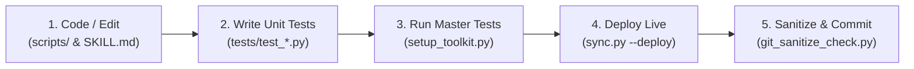

# Antigravity Agent Toolkit: Landmark & Maintenance Guardrails

> **Landmark Type**: System Toolkit Architecture & Invariants  
> **Repository**: `antigravity-toolkit` (Workspace Root)  
> **Master Test Command**: `python setup_toolkit.py`  
> **Live Deploy Command**: `python sync.py --deploy`

---

## 1. Architectural Mission & Invariants

This repository is the canonical, version-controlled incubator and source of truth for custom Antigravity skills, deterministic CLI automation, and agent guardrails.

### Non-Negotiable Invariants:
1. **Zero External Dependencies**: All tools must run on pure Python 3.8+ standard library (`pathlib`, `argparse`, `re`, `json`, `subprocess`, `unittest`, etc.). No `pip install` prerequisites.
2. **Windows Python Path**: On this system, always use `C:\msys64\mingw64\bin\python.exe`. Bare `python` resolves to the zero-byte Microsoft Store placeholder.
3. **No Machine Path Leaks**: Never hardcode personal machine paths (`C:\Users\...` or `/home/...`) in committed code or rules. Use `Path.home()`, `Path.cwd()`, or relative resolution.
4. **100% Test Coverage**: Every script in `scripts/` must have a corresponding test suite in `tests/` that passes via `python setup_toolkit.py`.
5. **No Local `.agents/skills/` Needed Here**: This repository *is* the origin of the skills. Live skills are mirrored to `~/.gemini/config/skills/` via `sync.py --deploy`, so they are already globally active when working in this workspace.

---

## 2. Standard Anatomy of a Skill

Every skill inside `skills/<skill-name>/` follows the official Antigravity skill layout (`SKILL.md` required; supporting directories added as needed):

```text
skills/<skill-name>/
├── SKILL.md            # Required: YAML frontmatter (name, description) + behavioral instructions
├── scripts/            # Optional: Deterministic Python CLI tooling (1 or more scripts, zero deps)
│   └── <name>_ctl.py
├── resources/          # Optional: Templates (e.g. HTML/CSS), schemas, or data files
├── examples/           # Optional: Reference implementations and usage patterns
├── references/         # Optional: Additional documentation loaded on demand
└── tests/              # Required if scripts/ exists: Unittest suite run by setup_toolkit.py
    └── test_<name>_ctl.py
```

### Frontmatter Standard (`SKILL.md`):
```yaml
---
name: skill-name
description: Clear, action-oriented description detailing what the skill does and when an agent should invoke it.
---
```

---

## 3. Skill Development & Maintenance Lifecycle

Follow this exact 5-step sequence whenever creating, modifying, or refactoring a skill:



### Step-by-Step Commands:
1. **Develop**: Edit script in `skills/<skill-name>/scripts/` and guidelines in `SKILL.md`.
2. **Test**: Run `C:\msys64\mingw64\bin\python.exe setup_toolkit.py`.
   * Ensure all tests across all skills pass with 0 errors.
3. **Deploy Live**: Run `C:\msys64\mingw64\bin\python.exe sync.py --deploy`.
   * Updates `~/.gemini/config/skills/` (skipping any skill listed in `sync.config.json` `"disabled"`). Never auto-prunes live skills.
   * To manually remove a skill from live config without deleting it from the repo, run `sync.py --recall <skill-name>` (or `--recall-disabled`).
4. **Sanitize**: Run `C:\msys64\mingw64\bin\python.exe skills/git-workflow-guard/scripts/git_sanitize_check.py`.
   * Verifies no hardcoded paths or API keys are staged.
5. **Commit**: Create an atomic Git commit with a clear conventional commit message (`feat(...)`, `fix(...)`, `docs(...)`).

---

## 4. Promotion from In-Project Skills (`skill-curator`)

When a bespoke skill is developed in a separate project workspace (inside `<workspace>/.agents/skills/<name>`):
1. The developer/agent tests it locally inside the project.
2. The agent promotes it: `python path/to/skill_ctl.py promote <name>`.
3. The promoted skill is copied into `antigravity-toolkit/skills/<name>`.
4. Run `python setup_toolkit.py` and commit the new skill to the toolkit repository.
