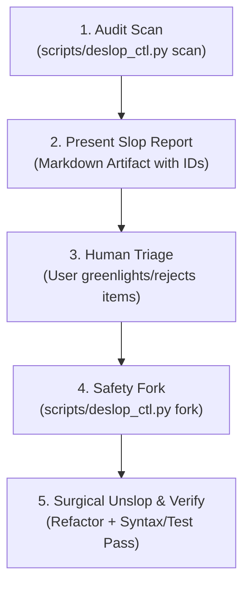

# `de-slop` - Codebase Grounding & De-Slopping Engine

A specialized skill for identifying and stripping artificial AI enterprise foam, conversational debris, defensive panic wrappers, and context-destroying meme variables—while strictly protecting battle-tested StackOverflow copypasta and platform workarounds.

---

## 1. The Core Philosophy

### The Two Faces of Slop

```
┌────────────────────────────────────────────────────────────────────────┐
│                          THE SLOP SPECTRUM                             │
├──────────────────────────────────┬─────────────────────────────────────┤
│      AI SLOP (The Paranoia)      │      HUMAN SLOP (The Brainrot)      │
├──────────────────────────────────┼─────────────────────────────────────┤
│ • Leaked chat comments           │ • Meme / in-joke variable names     │
│   ("# Fixed this for you")       │   (destroys AI semantic context)    │
│ • Hyper-verbose variable names   │ • Cryptic 1-letter variable soup    │
│   (40-character descriptive jaw- │ • Lost-in-time mystery comments     │
│    breakers)                     │   ("# temp hack until Tuesday")     │
│ • Empty exception hierarchies    │ • Unexplained magic numbers         │
│ • 1-method classes & 1-call      │ • Unknowable local idioms with      │
│   wrapper sprawl                 │   zero context                      │
│ • Panic `try/except: pass`       │                                     │
└──────────────────────────────────┴─────────────────────────────────────┘
                                   │
                                   ▼
             ┌───────────────────────────────────────────┐
             │   "CHESTERTON'S FENCE" (KEEP & GROUND)    │
             ├───────────────────────────────────────────┤
             │ Strange, ugly StackOverflow copypasta or  │
             │ weird edge-case patches that look like    │
             │ slop, but actually hold the system        │
             │ together. -> RECOMMEND: KEEP & ADD NOTE   │
             └───────────────────────────────────────────┘
```

### The Sacred Copypasta Invariant
**StackOverflow copypasta is sacred duct tape.** When code has an ugly 6-line snippet referencing a StackOverflow thread or an obscure Win32/POSIX workaround, it is usually the only thing standing between the application and a silent platform crash.
* **Never** "simplify" or "clean up" an ugly OS workaround or StackOverflow fix without understanding the bug it was copied to solve.
* Mark these findings as `[KEEP-FENCE-xx]` and recommend keeping them intact.

### The "Drowning in the Ocean" Invariant (Anti-Tool-Abdication)
> *"Me: Is it raining?  
> AI: Runs script.  
> Py: There is water. So it's raining.  
> AI: Didn't check. Py says it's raining, so it must be raining. Yes.  
> Me: Drowning in the middle of the ocean."*

**The script only checks for moisture; YOU are the agent with eyes.**
1. **Never Abdicate Judgment to the Script**: The CLI tool is a mechanical radar tripwire, not an infallible judge. Never blindly parrot its raw output.
2. **Filter Out False Alarms**: Inspect the actual lines flagged by the script. Discard scanner regex patterns, test fixtures, and legitimate low-level constants before presenting findings to the user.
3. **Catch the Invisible Rogue Wave**: If the script finds zero markers, but the code contains an overengineered 5-layer class hierarchy or 400 lines of enterprise boilerplate for a simple helper, call out the architectural drowning.

---

## 2. The 5-Step De-Slop Lifecycle

When instructed to de-slop a file or repository, **always follow this strict sequence**:



### Step 1: Audit Scan
Run the deterministic scanner against the target:
```bash
python path/to/deslop_ctl.py scan path/to/target --format md
```
Or for machine-readable JSON:
```bash
python path/to/deslop_ctl.py scan path/to/target --format json
```

### Step 2: Present the Slop Report & HARD STOP
Present the findings clearly to the user (in chat or as an artifact). The report must include:
1. **Executive Profile**: % AI Enterprise Foam vs. % Human Chaos vs. % Sacred Fences.
2. **Sacred Fences (KEEP)**: Highlight StackOverflow citations and platform workarounds to protect.
3. **High-Confidence AI Slop Checklist**: Numbered items (`[AI-CHAT-01]`, `[AI-WRAP-02]`, `[AI-EXC-03]`) ready for user sign-off.
4. **Semantic Grounding Table**: Propose natural, greppable domain names for meme variables and hyper-verbose AI identifiers.

> [!CAUTION]
> **MANDATORY HARD STOP**: The agent MUST STOP calling tools after presenting the audit report.
> **DO NOT** modify, edit, or strip any files until the user explicitly responds with a greenlight.
> **NEVER** assume silence or partial feedback is a blanket approval. If the user only mentions 1 or 2 items (e.g. *"keep #3"*), the agent must clarify or only operate on what was explicitly approved—never assume permission to touch the rest.

### Step 3: Human Triage & Explicit Greenlight
Wait for user input. The user may say:
> *"Kill all AI-CHAT, inline AI-WRAP-01, rename HUMAN-MEME-01, but keep AI-PANIC-02 because that library throws random IOErrors."*

Only actions explicitly confirmed by the user are scheduled for execution. If the user's intent on other items is ambiguous, ask before proceeding.

### Step 4: Safety Fork
Before modifying any files, ensure a rollback path exists:
```bash
python path/to/deslop_ctl.py fork path/to/repo_or_dir
```
* If inside a Git repository, this creates an automated `deslop-backup-<timestamp>` branch without disturbing working state.
* If outside Git, it copies all target files into a timestamped `.deslop_backup_<timestamp>/` directory.

### Step 5: Surgical Unslop & Verification
Apply approved removals and renames:
1. Strip conversational debris:
   ```bash
   python path/to/deslop_ctl.py strip path/to/file.py
   ```
2. Refactor single-method classes into top-level functions.
3. Replace empty custom exceptions with standard library exceptions (`ValueError`, `RuntimeError`, `KeyError`).
4. Apply approved variable renames.
5. **Verify**: Run `ast.parse()` or the repository's test suite to ensure zero broken functionality.

---

## 3. CLI Quick Reference

The CLI tool runs with pure Python standard library (zero external dependencies):

```bash
# Scan a directory or single file (terminal text output)
python path/to/deslop_ctl.py scan src/

# Export full Markdown triage report
python path/to/deslop_ctl.py scan src/ --format md -o report.md

# Export machine-readable JSON
python path/to/deslop_ctl.py scan src/ --format json

# Create safety backup branch / filesystem snapshot
python path/to/deslop_ctl.py fork .

# Preview conversational comment removal (Dry Run)
python path/to/deslop_ctl.py strip src/main.py --dry-run

# Execute surgical conversational comment removal
python path/to/deslop_ctl.py strip src/main.py
```
