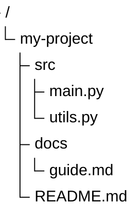

# `doc-hygiene` - Documentation Integrity & Tree Controller

This skill equips the agent with automated documentation hygiene tools. It keeps project directory trees up-to-date without manual ASCII typing, detects broken relative markdown links before commits, and verifies target search strings before executing file edits.

---

## 1. When to Use

Reach for `doc-hygiene` when:
1. **Generating or Refreshing Repository Trees**: Update directory structures in `README.md`, `AGENTS.md`, or architecture documents.
2. **Interactive Visual Trees**: Render directory trees using native Mermaid `treeView-beta` syntax.
3. **Auditing Relative Links**: Check `tasks/`, `docs/`, and `README.md` for broken relative file links before milestone releases.
4. **Pre-Flight Edit Verification**: Verify that a multi-line code snippet exists and is unique before calling `edit_file`.

---

## 2. Global Tool Execution

**Script Path**:  
`C:\Users\AlitheiaDeus\DeusLocker\AI\antigravity-toolkit\skills\doc-hygiene\scripts\doc_ctl.py`

### CLI Quick Reference

```bash
# -------------------------------------------------------------
# 1. FILE TREE GENERATION & IN-PLACE UPDATING
# -------------------------------------------------------------

# Direct to AI/Terminal (ASCII tree to stdout)
python "C:\Users\AlitheiaDeus\DeusLocker\AI\antigravity-toolkit\skills\doc-hygiene\scripts\doc_ctl.py" tree

# In-Place Overwrite between <!-- TREE_START --> and <!-- TREE_END --> in README.md
python "C:\Users\AlitheiaDeus\DeusLocker\AI\antigravity-toolkit\skills\doc-hygiene\scripts\doc_ctl.py" tree --doc README.md

# Render as native Mermaid treeView-beta diagram into documentation
python "C:\Users\AlitheiaDeus\DeusLocker\AI\antigravity-toolkit\skills\doc-hygiene\scripts\doc_ctl.py" tree --format mermaid --doc README.md

# Export standalone tree snapshot with timestamp
python "C:\Users\AlitheiaDeus\DeusLocker\AI\antigravity-toolkit\skills\doc-hygiene\scripts\doc_ctl.py" tree --output docs/structure.txt --timestamp

# -------------------------------------------------------------
# 2. MARKDOWN RELATIVE LINK VERIFICATION
# -------------------------------------------------------------

# Audit all markdown files in current project for dead relative links
python "C:\Users\AlitheiaDeus\DeusLocker\AI\antigravity-toolkit\skills\doc-hygiene\scripts\doc_ctl.py" links

# Audit a specific subdirectory (e.g. tasks/ or docs/)
python "C:\Users\AlitheiaDeus\DeusLocker\AI\antigravity-toolkit\skills\doc-hygiene\scripts\doc_ctl.py" links tasks/

# -------------------------------------------------------------
# 3. EDIT PRE-FLIGHT STRING VERIFIER
# -------------------------------------------------------------

# Verify a target string is unique (1 match) before editing
python "C:\Users\AlitheiaDeus\DeusLocker\AI\antigravity-toolkit\skills\doc-hygiene\scripts\doc_ctl.py" verify path/to/file.py --target "def calculate_crc("
```

---

## 3. In-Place Marker Syntax

Place these HTML comment markers in your documentation (e.g. in `README.md` or `AGENTS.md`). The tool replaces only the content between the markers, leaving all surrounding text untouched:

```markdown
## Repository Structure

<!-- TREE_START -->
(auto-generated tree lives here)
<!-- TREE_END -->
```

---

## 4. Supported Tree Formats

### A. ASCII Tree (`--format ascii`, default)
```text
my-project/
├── src/
│   ├── main.py
│   └── utils.py
├── docs/
│   └── guide.md
└── README.md
```

### B. Mermaid `treeView-beta` (`--format mermaid`)
Renders an interactive, visual tree widget on GitHub and in Markdown previewers:
````markdown

````

### C. Markdown List (`--format markdown`)
* **my-project/**
  * **src/**
    * `main.py`
    * `utils.py`
  * `README.md`
