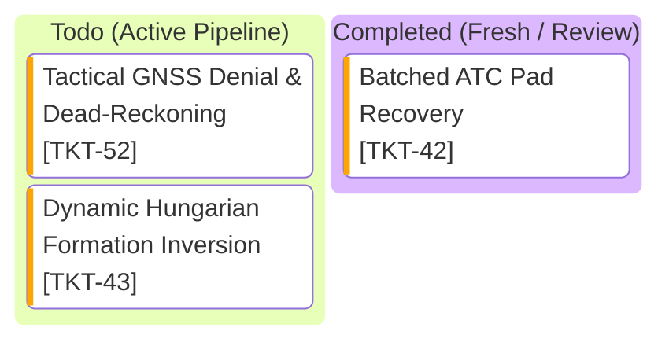

# `kanban-workflow-guard` - Modular Task Lifecycle & Kanban Guard

This skill governs how AI coding assistants interact with project Kanban task tracking. It establishes a clean separation across a **Modular Task Architecture** (1-Card-1-Doc) and prevents the anti-patterns of **monolithic scope bloat**, **silent ticket clearing**, **parallel task fragmentation**, and **table-cell essay hoarding**.

---

## 1. The Modular Task Architecture (1-Card-1-Doc)

Task tracking is partitioned across distinct modular files to keep every document small, readable, and within agent tool limits (< 15 KB):

| Document / Directory | Primary Role & Lifecycle State | Purpose & Rules |
| :--- | :--- | :--- |
| **`kanban.md`** | **Active Working Board & Index HUD** | The active tactical HUD. Contains the live visual Mermaid `kanban` diagram (at-a-glance titles & metadata) and a lean 5-column glance index table (< 120 chars/row) linking to task files. Strictly no multi-paragraph essays in table cells. |
| **`tasks/`** | **Active Task Specifications** | Individual, isolated 1-card-1-doc Markdown specifications (`tasks/TKT-xx.md` for `todo` and `completed` review). Each file is ~50–80 lines (2–4 KB) with full blueprints, formulas, and tests. |
| **`tasks/backlog/`** | **Candidate Roadmap Specs** | Scoped roadmap candidates and parked gimmick specifications awaiting promotion to active `todo`. |
| **`tasks/archived/`** | **Verified Historical Records** | Permanent historical archive of completed, developer-verified task blueprints and settled milestone bundles. |
| **`kanban_archive.md`** | **Settled Milestone Ledger** | High-level chronological milestone ledger summarizing major releases and settled architectural invariants. |

---

## 2. Ticket Prefix Standard & Taxonomy

Every card on the board must carry a standardized prefix that strictly defines its intent, execution state, and scope:

| Prefix | Category & Intent | Meaning & Lifecycle Rules |
| :--- | :--- | :--- |
| **`TKT-xx`** | **Feature / Implementation (For Doing)** | Scoped, planned, and ready for active coding. Moves through `todo` $\rightarrow$ `in_progress` $\rightarrow$ `completed`. |
| **`FIX-xx`** / **`BUG-xx`** | **Bug Remediation (For Doing)** | Dedicated to defect resolution and regressions. Actionable, scoped, and prioritized for active coding. |
| **`PLN-xx`** | **Future Candidate (Roadmap Consideration)** | A new feature or change being considered for the future, but **not yet committed to implementation**. Resides in `reported` (or `tasks/backlog/`) until explicitly scoped and promoted to `todo`. |
| **`TLK-xx`** | **Major Architectural Reform (Discussion)** | A major architectural shift or complex design topic requiring deep planning, documentation, and user communication. Spawns concrete `TKT` or `PLN` tickets. |

> **Key Rule: Numbers Do NOT Dictate Execution Order**:  
> Ticket IDs (e.g. `TKT-25`, `FIX-01`, `TKT-07`) are unique persistent identifiers, **not** chronological sequence numbers. Work order is determined by priorities, architectural dependencies, and explicit developer direction — not integer order.

---

## 3. Mermaid Kanban Syntax Standard: Square Brackets in Metadata

In Mermaid `kanban` blocks, card metadata **must** enclose the ticket key in square brackets, and card labels must be concise (at-a-glance titles):



* **Correct**: `@{ ticket: '[TKT-52]', priority: 'High' }`
* **Incorrect**: `@{ ticket: 'TKT-52', priority: 'High' }`

---

## 4. The Cardinal Rules of Board Discipline

### 1. No Silent Clearing / Deletion
* **NEVER** delete or purge active cards from `kanban.md` or `tasks/` on your own initiative.
* Archiving verified cards from `tasks/` to `tasks/archived/` requires developer sign-off.

### 2. Strict Single-WIP Focus (WIP = 1)
* The `in_progress` column must contain **at most ONE active ticket** being actively developed.
* Before picking up a new task, confirm that no card is stranded in `in_progress`.

### 3. Verification Gate (Code Deliverables Only)
* **Zero Tests for Non-Code Changes**: Never execute unit tests, smoke tests, or verification scripts for documentation, `kanban.md`, comments, or asset/CSS styling.
* **Targeted Verification for Code**: A code ticket transitions to `completed` only when:
  1. All code changes for the ticket are implemented.
  2. The specific targeted test module for the touched file passes cleanly (e.g. `python -m unittest tests/test_gnss_denial.py`).
  3. Meaningful tests validate concrete physical invariants and state machines, not vanity boilerplate.

### 4. Index Table Standard (Zero Table Bloat in `kanban.md`)
* The table in `kanban.md` is strictly a **5-column glance index**:
  `| Ticket ID | Grade | Title | Operational Inspiration | Spec Document |`
* **STRICTLY FORBIDDEN**: Never write multi-paragraph acceptance criteria, root-cause post-mortems, or LaTeX formulas into `kanban.md` table cells. All detailed technical documentation belongs exclusively in `tasks/TKT-xx.md`.

### 5. Developer Sign-Off for Archival
* `Completed (Fresh / Review)` is a staging observation area for developer verification.
* Tasks move from `tasks/` to `tasks/archived/` only after explicit developer sign-off (e.g. "Looks good, archive ticket 42").

---

## 5. Multi-Document Lifecycle Flow

```
[TLK / PLN Idea] (kanban.md: reported)
       │
       ├──> (Overly ambitious / anti-burnout stash) ──> (kanban.md: frozen)
       │
       ▼ (Scoping & Discussion)
[Technical Architecture & Specs] (Created as tasks/backlog/TKT-xx.md in backlog)
       │
       ▼ (Promoted to Active Todo)
[Active Task File] (Moved to tasks/TKT-xx.md & indexed in kanban.md: todo)
       │
       ▼ (WIP = 1 Active Coding / Recovery Anchor)
[Active Development] (kanban.md: in_progress)
       │
       ▼ (Targeted Verification Passes)
[Staging Review] (kanban.md: completed)
       │
       ├──> (Developer Sign-off) ──> tasks/archived/ & noted in kanban_archive.md
       └──> (Shelve / Abandon)   ──> tasks/archived/shelved/ & [SHELVED] ledger
```

---

## 6. Automated Board Management with `kanban_ctl.py`

To eliminate manual Markdown errors, prevent broken Mermaid syntax, and enforce board rules automatically, always route board operations through the global helper script:

**Script Path**:  
`$HOME/.gemini/config/skills/kanban-workflow-guard/scripts/kanban_ctl.py`

### CLI Quick Reference

```bash
# 1. Initialize a new project with compliant kanban & task folders
python "$HOME/.gemini/config/skills/kanban-workflow-guard/scripts/kanban_ctl.py" init --title "My Project"

# 2. Add a new card & scaffold its 1-card-1-doc spec
python "$HOME/.gemini/config/skills/kanban-workflow-guard/scripts/kanban_ctl.py" add --id TKT-14 --title "JWT Refresh Rotation" --priority High
python "$HOME/.gemini/config/skills/kanban-workflow-guard/scripts/kanban_ctl.py" add --id PLN-03 --title "Drone Show Splines" --column reported

# 3. Lifecycle Transitions
python "$HOME/.gemini/config/skills/kanban-workflow-guard/scripts/kanban_ctl.py" freeze PLN-03   # Stash to frozen (burnout mitigation)
python "$HOME/.gemini/config/skills/kanban-workflow-guard/scripts/kanban_ctl.py" promote TKT-14  # Move to active todo
python "$HOME/.gemini/config/skills/kanban-workflow-guard/scripts/kanban_ctl.py" start TKT-14    # Move to in_progress (strictly enforces WIP=1)
python "$HOME/.gemini/config/skills/kanban-workflow-guard/scripts/kanban_ctl.py" review TKT-14   # Move to completed (fresh review)

# 4. Anti-Burnout Shelving (Clear clutter WITHOUT fake-completing!)
python "$HOME/.gemini/config/skills/kanban-workflow-guard/scripts/kanban_ctl.py" shelve PLN-03 --reason "Dropped in favor of simpler alternative"

# 5. Milestone Archival (On developer sign-off)
python "$HOME/.gemini/config/skills/kanban-workflow-guard/scripts/kanban_ctl.py" archive TKT-14 --milestone "v1.2-Auth"

# 6. Task Inspection & Reading Specs
python "$HOME/.gemini/config/skills/kanban-workflow-guard/scripts/kanban_ctl.py" locate TKT-14  # Output exact path & board status
python "$HOME/.gemini/config/skills/kanban-workflow-guard/scripts/kanban_ctl.py" cat TKT-14     # Dump markdown spec to stdout

# 7. Board Integrity Audit & Overview
python "$HOME/.gemini/config/skills/kanban-workflow-guard/scripts/kanban_ctl.py" validate      # Verify zero orphan files & valid syntax
python "$HOME/.gemini/config/skills/kanban-workflow-guard/scripts/kanban_ctl.py" list          # Terminal glance view
```
