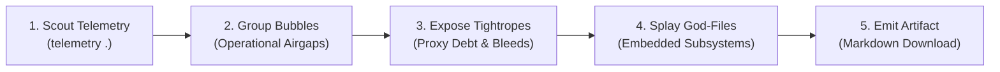

# `system-mapper` - Executive Architecture Cartographer & Intent Scout

`system-mapper` bridges the gap between **blind syntactic file crawling** and **intent-driven architectural modeling**. It combines a deterministic telemetric scout (`system_mapper_ctl.py`) with agent cognitive synthesis to unpack monolithic God-files, surface hidden subsystems, detect "Tightrope" proxy debt and in-memory airgap bleeds, and render colorized, C4-style Mermaid flowcharts and system ledgers.

It empowers **non-coders, technical product managers, domain experts, and engineering leads** to inspect systems at a glance, understand operational airgaps, and issue directive, high-level fixes without getting lost in implementation syntax.

---

## 1. When to Use

Reach for `system-mapper` whenever:
1. **System Orientation & Onboarding**: You or the user need a high-level breakdown of what each module does in an unfamiliar or complex codebase.
2. **Explaining Architecture to Non-Coders**: The user wants an intuitive, color-coded visual map showing operational bubbles, dataflows, and dependencies.
3. **Architectural Triage & Debt Audits**: Spotting monolithic God-files (>500 lines), in-memory boundary bleeds (e.g. web server holding simulator in-memory), and proxy method tightropes.
4. **Harvesting Roadmap Intent**: Mapping active task tags (`TKT-XX`, `TODO`) directly onto the architecture diagram to track active refactoring.
5. **Validating High-Level Fixes**: Allowing a product manager or lead to review critical paths and airgap boundaries before approving large refactors.

---

## 2. Global Tool Execution

**Script Path**:  
`$HOME/.gemini/config/skills/system-mapper/scripts/system_mapper_ctl.py`

*(Windows native environment: `C:\msys64\mingw64\bin\python.exe`)*

### CLI Quick Reference

```bash
# 1. Run Architectural Telemetry (Scouts God-files, tightropes, tickets, and network ports)
python "$HOME/.gemini/config/skills/system-mapper/scripts/system_mapper_ctl.py" telemetry .

# 2. Generate full executive report (Mermaid Diagram + Telemetry Briefing + Ledger)
python "$HOME/.gemini/config/skills/system-mapper/scripts/system_mapper_ctl.py" report .

# 3. Output only the colorized Mermaid C4-style flowchart
python "$HOME/.gemini/config/skills/system-mapper/scripts/system_mapper_ctl.py" map .

# 4. Output the plain-English System Ledger table
python "$HOME/.gemini/config/skills/system-mapper/scripts/system_mapper_ctl.py" table .

# 5. Exclude noise/test directories from the architectural scan
python "$HOME/.gemini/config/skills/system-mapper/scripts/system_mapper_ctl.py" report . --exclude tests,docs,fixtures

# 6. Filter and focus on a specific subsystem (e.g. 'billing' or 'sim')
python "$HOME/.gemini/config/skills/system-mapper/scripts/system_mapper_ctl.py" map . --focus sim

# 7. Export structured JSON telemetry for programmatic consumption
python "$HOME/.gemini/config/skills/system-mapper/scripts/system_mapper_ctl.py" telemetry . --json
```

---

## 3. The 4-Step Cognitive Architecture Protocol

Do not dump raw, blind file trees. An agent executing `system-mapper` must apply the **Cognitive Architecture Protocol**:



### Step 1: Scout Telemetry (`telemetry .`)
Run the scout to gather quantitative architectural facts:
* **God-Files**: Files > 500 lines, their inner method clusters, and embedded instances.
* **The Tightropes**: Classes with $\ge 3$ proxy delegation methods or in-memory boundary bleeds (`self.sim` held inside a web server).
* **Roadmap Tickets**: `TKT-XX`, `TODO`, `FIXME` mapped to line numbers.
* **Network Endpoints**: Ports (`9000`, `9001`, `14550`) and protocols (MAVLink, WebSocket, REST).

### Step 2: Define Operational Bubbles (Not Just Folders)
Group components into logical domains reflecting real-world airgaps:
* e.g., `Bubble 1: Ground Control Station (Operator Airgap)`
* e.g., `The Canyon Airgap (Network Boundary)`
* e.g., `Bubble 2: SITL World Simulator (God-View Airgap)`
* e.g., `Bubble 3: Autonomous Fleet (Brain Airgap)`

### Step 3: Expose The Tightropes
Never hide architectural debt behind clean arrows. Use the tightrope palette:
* **Clean Network Comms**: Solid arrows `<-->` (UDP, WebSocket, REST).
* **The Tightropes**: Dashed amber arrows `-.->|Direct In-Memory Call|` showing where components cheat across boundaries.
* **Kinematic / Ground Truth Stepping**: Thick lines `===`.

### Step 4: Splay God-Files into Embedded Subsystems
If a file is 2,000–4,000 lines (e.g., `sitl_engine.py`), do not leave it as one box. Unpack its inner subsystems:
* `rf_subsys`: RF Channel & Jammer Math (~500 L)
* `urban_geom`: Urban 3D Geometry
* `atc_subsys`: Batched ATC Recovery (~320 L)
* Annotate with relevant ticket numbers (e.g. `Targets for TKT-61`).

### Step 5: Emit Downloadable Artifact
Always publish the result into `<appDataDir>\brain\<conversation-id>\system_architecture_map.md` using `write_file` with `ArtifactMetadata` (`UserFacing: true`).

---

## 4. The C4 Color Palette Standard

| Color | Badge | Architectural Role | Meaning at a Glance |
| :--- | :--- | :--- | :--- |
| **Blue** (`#1e40af`) | 🔵 | **Entrypoint / API / UI** | Where users, viewports, or external traffic enter the system. |
| **Green** (`#166534`) | 🟢 | **Core Logic / Services** | Where business rules, kinematics, and algorithms execute. |
| **Amber** (`#854d0e`) | 🟡 | **Async / Queues / Workers** | Background jobs, delayed tasks, message consumers, cron schedulers. |
| **Purple** (`#581c87`) | 🟣 | **Storage / State** | Persistent data stores, caches, ORM models, migration schemas. |
| **Dark Slate** (`#374151`)| ⚪ | **External Integration** | Third-party APIs, payment gateways, outbound webhooks. |
| **Red** (`#991b1b`) | 🔴 | **Hotspot / Tech Debt** | Deprecated files, bottlenecks, circular loops. |
| **Dashed Amber** (`#ffb800`)| 🟨 | **The Tightropes** | In-memory boundary leaks, monolithic proxy delegations. |

---

## 5. Verification & Master Tests

All tools in this skill must adhere to the zero external dependencies policy and pass the master test suite:

```bash
C:\msys64\mingw64\bin\python.exe setup_toolkit.py
```
